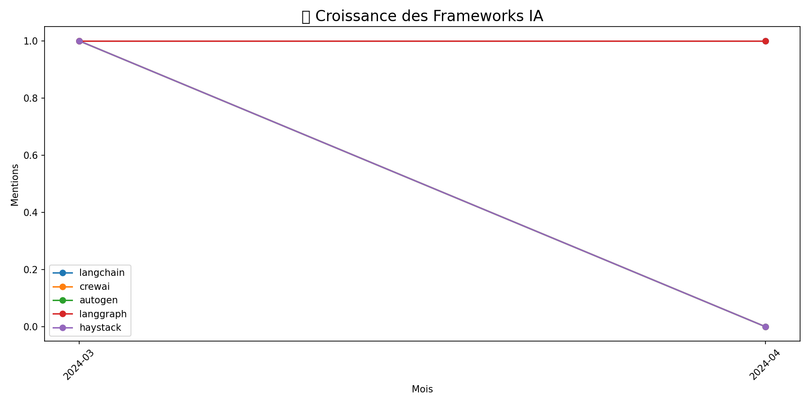
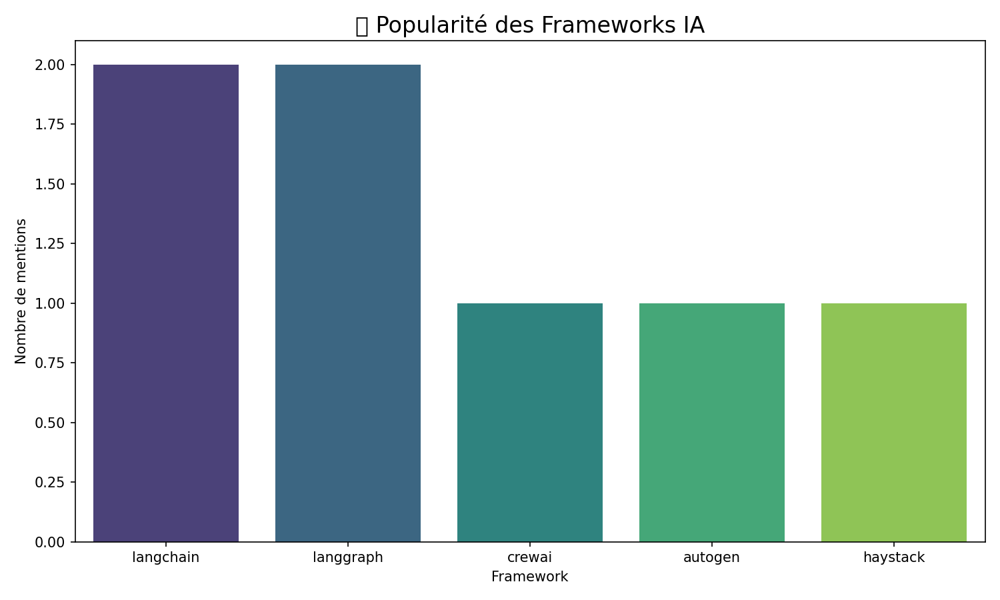

# 🚀 AI-Tech-Watcher
### Plateforme intelligente de veille technologique et stratégique

AI-Tech-Watcher est un projet Python dédié à l'automatisation de la veille technologique dans le domaine de l'Intelligence Artificielle et des nouvelles technologies.

La plateforme collecte des informations provenant de différentes sources spécialisées, centralise les données, analyse les tendances technologiques et génère des visualisations permettant de mieux comprendre l'évolution de l'écosystème IA.

L'objectif est de transformer des informations dispersées en données structurées et exploitables pour faciliter la prise de décision.

---

## 🎯 Objectifs du projet

- Automatiser la collecte d'informations technologiques.
- Surveiller les tendances et innovations en Intelligence Artificielle.
- Centraliser les articles, actualités, repositories, modèles et publications scientifiques.
- Nettoyer et structurer les données collectées.
- Analyser les mentions et les tendances des différents frameworks.
- Générer des indicateurs et des visualisations comparatives.
- Exploiter une base de connaissances pour contextualiser les analyses.

## ✨ Fonctionnalités principales

### 1. Collecte automatisée
- Récupération des actualités depuis plusieurs sources technologiques.
- Collecte des publications scientifiques et des modèles IA.
- Surveillance des repositories GitHub Trending.
- Extraction des informations à partir de flux RSS, API et pages web.

### 2. Nettoyage et préparation des données
- Nettoyage des données collectées.
- Structuration et normalisation des informations.
- Préparation des données pour les étapes d'analyse.

### 3. Analyse technologique
- Analyse des mentions des différents frameworks.
- Calcul du sentiment moyen.
- Évaluation et comparaison des technologies.
- Génération de scores globaux et de classements.

### 4. Base de connaissances
- Centralisation des informations contextuelles.
- Gestion des connaissances technologiques.
- Mise à disposition du contexte nécessaire à l'analyse.

### 5. Visualisation des résultats
- Graphique d'évolution des tendances.
- Comparaison des mentions technologiques.
- Visualisation des indicateurs de sentiment.
- Tableau comparatif des frameworks.

## 🏗️ Architecture du projet

```text
AI-Tech-Watcher/
│
├── analysis/
│   ├── analysis.py
│   ├── cleaner.py
│   ├── scorer.py
│   └── visualizer.py
│
├── knowledge_base/
│   ├── knowledge_base.py
│   └── data_internal.json
│
├── outputs/
│   ├── graphs/
│   │   ├── growth_line.png
│   │   ├── mentions_bar.png
│   │   └── sentiment_radar.html
│   │
│   └── tables/
│       └── tableau_comparatif.csv
│
├── collector.py
├── requirements.txt
├── .env.example
├── .gitignore
└── README.md
```

### Description des modules

| Module | Responsabilité |
|---|---|
| `collector.py` | Collecte des données technologiques |
| `analysis/cleaner.py` | Nettoyage des données |
| `analysis/analysis.py` | Analyse des informations |
| `analysis/scorer.py` | Calcul des scores et indicateurs |
| `analysis/visualizer.py` | Génération des visualisations |
| `knowledge_base/` | Gestion de la base de connaissances |
| `outputs/` | Stockage des résultats et graphiques |

## 🛠️ Technologies utilisées

| Technologie | Utilisation |
|---|---|
| Python | Développement principal |
| LangGraph | Architecture de traitement orientée agents |
| BeautifulSoup | Extraction de données web |
| Requests | Requêtes HTTP et accès aux API |
| feedparser | Lecture des flux RSS |
| Pandas | Manipulation des données |
| Matplotlib | Visualisation des résultats |
| Plotly | Visualisations interactives |

## 🌐 Sources de données

Le système surveille plusieurs sources spécialisées :

| Source | Type d'information |
|---|---|
| Hugging Face Blog | Actualités IA |
| OpenAI Blog | Innovations IA |
| Google DeepMind | Recherche et innovation |
| Meta AI | Recherche en Intelligence Artificielle |
| MIT Technology Review | Actualités technologiques |
| ArXiv cs.AI | Publications scientifiques |
| ArXiv cs.LG | Machine Learning |
| Towards Data Science | Articles techniques |
| The Gradient | Recherche en IA |
| AI Alignment Forum | Recherche et réflexion sur l'IA |
| GitHub Trending | Projets et repositories |
| Hacker News | Actualités technologiques |
| Hugging Face Hub | Modèles d'IA |
| Hugging Face Daily Papers | Publications scientifiques |

Les données sont récupérées à travers des flux RSS, des API officielles et des techniques d'extraction web.

## 📊 Résultats et visualisations

Le projet génère plusieurs représentations permettant d'explorer les tendances technologiques.

**Évolution des tendances**



**Comparaison des mentions**



**Analyse interactive du sentiment**

[Consulter la visualisation interactive](outputs/graphs/sentiment_radar.html)

**Tableau comparatif des frameworks**

Fichier : `outputs/tables/tableau_comparatif.csv`

Les indicateurs disponibles comprennent :
- Nombre de mentions.
- Sentiment moyen.
- Score global.
- Classement des frameworks.

## ⚙️ Installation et configuration

### Prérequis

- Python 3.10 ou supérieur.
- Git.
- pip.

### 1. Cloner le repository

```bash
git clone https://github.com/TON_USERNAME/AI-Tech-Watcher.git
```

```bash
cd AI-Tech-Watcher
```

### 2. Créer un environnement virtuel

```bash
python -m venv venv
```

### 3. Activer l'environnement

**Windows :**

```powershell
venv\Scripts\activate
```

**Linux / macOS :**

```bash
source venv/bin/activate
```

### 4. Installer les dépendances

```bash
pip install -r requirements.txt
```

### 5. Configurer les variables d'environnement

Créer un fichier `.env` à partir du modèle fourni :

**Windows :**

```powershell
copy .env.example .env
```

**Linux / macOS :**

```bash
cp .env.example .env
```

Renseigner les clés API nécessaires :

```env
GITHUB_TOKEN=your_github_token_here
HF_TOKEN=your_huggingface_token_here
```

Les clés API sont facultatives selon les sources utilisées. Hacker News propose notamment une API publique.

### 6. Lancer le collecteur

```bash
python collector.py
```

## 🔐 Configuration des API

Les services suivants peuvent être configurés :

- **GitHub API :** https://github.com/settings/tokens
- **Hugging Face :** https://huggingface.co/settings/tokens
- **Hacker News API :** https://github.com/HackerNews/API

Ne jamais publier de véritables clés API dans le repository.

## 📁 Format des données

Les informations collectées sont structurées autour de plusieurs champs :

| Champ | Description |
|---|---|
| `source` | Source de l'information |
| `type` | Catégorie du contenu |
| `title` | Titre |
| `url` | Lien vers la publication |
| `summary` | Résumé |
| `published` | Date de publication |
| `collected_at` | Date de collecte en UTC |

## 🔮 Perspectives d'évolution

Plusieurs améliorations peuvent enrichir la plateforme :

- Développer un tableau de bord interactif.
- Ajouter de nouvelles sources de données.
- Améliorer les méthodes d'analyse de sentiment.
- Intégrer des mécanismes de détection des tendances émergentes.
- Enrichir les capacités d'analyse et de génération de rapports.
- Améliorer l'automatisation du pipeline de veille technologique.

## 👨‍💻 Auteur

**Hamza Kassimi**

Ingénieur en Intelligence Artificielle et Science des Données (AISDR) — EMSI Rabat.

Intéressé par l'Intelligence Artificielle, la Data Science, le Machine Learning et le développement de solutions intelligentes.

---

⭐ *AI-Tech-Watcher — Transforming technological information into actionable insights.*
